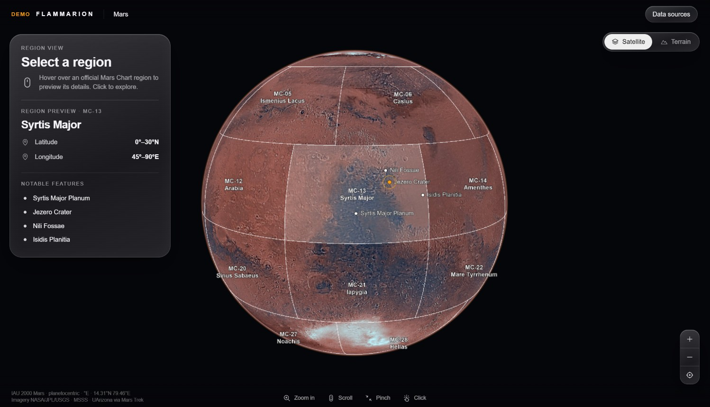
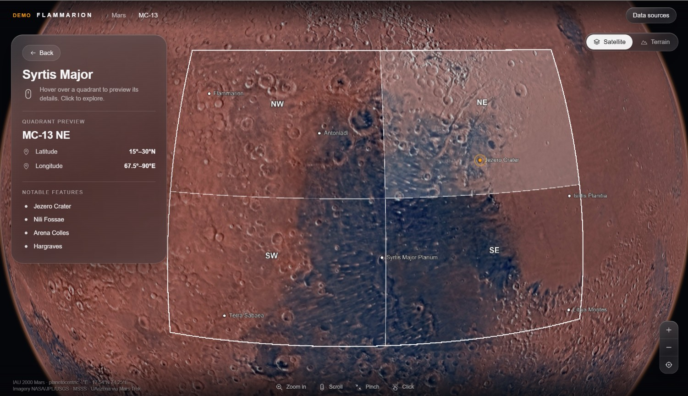
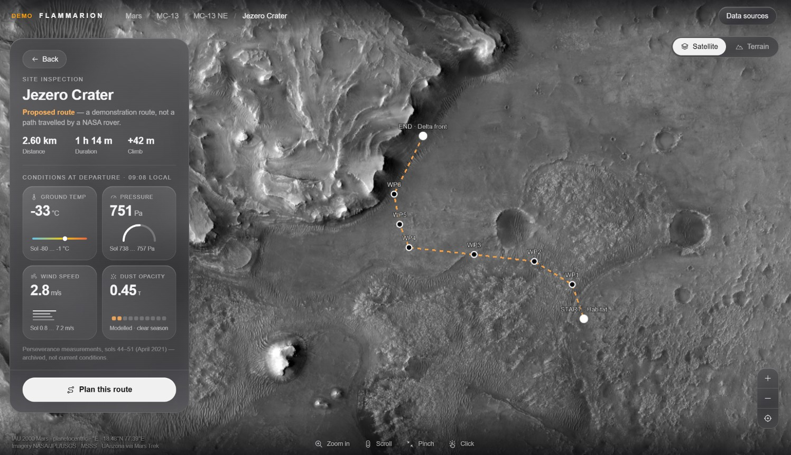
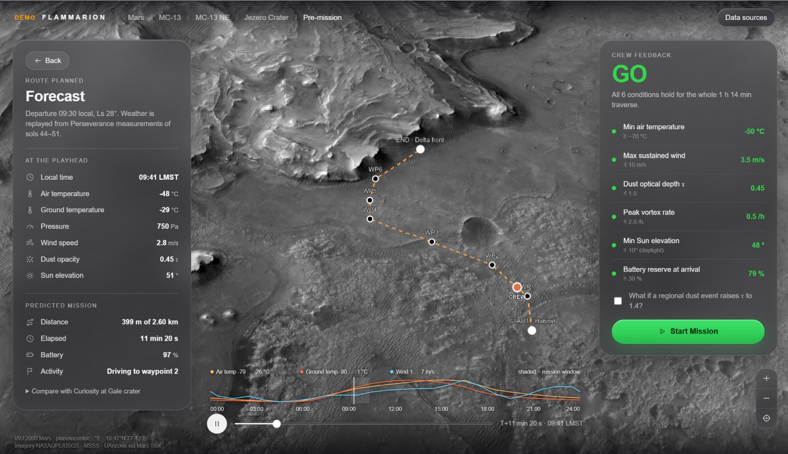
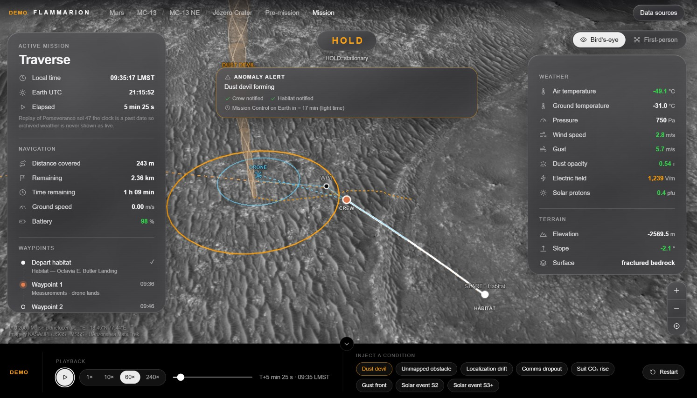
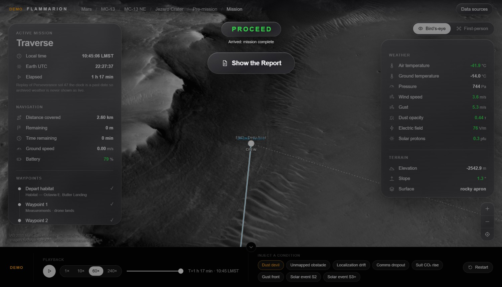

# FLAMMARION

The FLAMMARION project addresses the challenge of an end-to-end Mars traversal mission planning and deployment application. First and foremost it is developed to ensure astronauts safety during their surface exploratory missions, for the purpose of the Hackathon an example to the Jezero Crater is shown. The project integrates terrain exploration, pre-mission environmental assessment, and real-time mission monitoring - the latter supported by an autonomous scout drone. 

The app consists of three stages, guiding astronauts and mission planners through each phase of the mission:

* Area-to-Region Navigation: smooth 3D zoom from a global view of Mars down to mission-specific terrain, powered by NASA/USGS orbital imagery and elevation models,  enabling broad-scale site analysis before committing to a route.

* Pre-Mission Planning: A trajectory planner and environmental timelapse simulator that combines historical Curiosity and Perseverance data with emulated power telemetry to generate a clear GO / NO-GO readiness assessment.

* Intra-mission Monitoring: A real-time Heads-Up Display that tracks astronaut life support, local Sol/GMT time, 30 cm-accuracy localization, and an autonomous scout drone flying 100–150 meters ahead, warning about hazardous anomalies. All supported by the 

We paired real scientific datasets from NASA missions with a boolean-flag decision engine (PROCEED / HOLD / REROUTE / ABORT), to solve the challenge of planetary situational awareness. Thanks to drone inspection, we allow for detecting rapidly forming dust devils and updating terrain hazards, before they endanger human crews on Mars, to increase chances of the mission success.


## How to open the app

You need [Node.js](https://nodejs.org) 20 or newer and an internet connection (the Mars imagery is streamed from NASA).

1. Get the code. The app currently lives on the `claude/new-session-uabkbg` branch, not on `main`:

```bash
git clone -b claude/new-session-uabkbg https://github.com/Barnabaki/FLAMMARION.git
```

```bash
cd FLAMMARION
```

2. Install the dependencies (once):

```bash
npm install
```

3. Start the app:

```bash
npm run dev
```

4. Open http://localhost:5173 in Chrome, Edge or Firefox. Keep the terminal open while you use the app; press `Ctrl+C` in it to stop.

### Using it

1. Pick the **Jezero Crater** mission, then click the planet to show the 30 official map regions.
2. Hover a region to preview it, click **MC-13 Syrtis Major**, then the **NE** quadrant, then **Jezero Crater** (on the map or in the feature list). An orange pulse marks the mission site on the way down.
3. Inspect the site and click **Plan this route**.
4. Watch the forecast and, with the assessment at **GO**, click **Start Mission**.
5. In the mission view, switch between **Bird's-eye** and **First-person**, and use **Simulation tools** to change the playback speed or trigger a dust devil, an unmapped obstacle and other conditions.
6. When the traverse ends, click **Show the Report**.

| | | |
|:---:|:---:|:---:|
|  |  |  |
| **1.** Pick the mission and region | **2.** Zoom into Jezero Crater | **3.** Plan the route |
|  |  |  |
| **4.** Start the mission | **5.** Watch the traverse | **6.** View the report |

Hover any value to see what kind of data it is; click it to open **Data sources** at its source. The breadcrumb takes you back to any earlier level, and **Satellite / Terrain** switches the globe between imagery and MOLA elevation.

## Development

| Command | Purpose |
| --- | --- |
| `npm run build` / `npm run preview` | Production build into `dist/` and local preview |
| `npm run generate` | Regenerate every file in `public/data/` and `examples/` (deterministic, seeded) |
| `npm test` | 14 checks: geodesy, Mars24 reference epoch, quadrangle geometry, 30 cm localization model, decision engine, all anomaly scenarios, drone-schema validation, DEM and MEDA consistency with the source files |
| `python3 scripts/build_app_assets.py` | Rebuild the derived assets (terrain grid, route DEM crop, weather tables, MOLA crop) from `data/source/`; needs numpy, pillow, tifffile, imagecodecs. Outputs are committed. |

`npm install` copies Cesium's runtime assets to `public/cesiumStatic/` (git-ignored) via `scripts/copy-cesium.mjs`.

## Architecture

```
index.html
src/
  main.js          app shell: top bar, breadcrumb, stage switching, sources panel
  viewer.js        Cesium viewer on the Mars ellipsoid + NASA Trek imagery layers
  moduleA.js       globe → quadrangles → MC-13 → NE → Jezero terrain & route
  moduleB.js       pre-mission forecast, GO / NO-GO, Start Mission
  moduleC.js       intra-mission HUD, two screens, drone marker, demo-only simulation tools footer
  routeLayer.js    route / waypoint / crew entities shared by all modules
  sources.js       provenance tags and the dataset list behind the Data sources panel
  style.css        Liquid Glass UI styles
  ui/              DOM helpers (dom.js) and line icons (icons.js)
  lib/             pure JS, no DOM — shared by browser, generator and tests
    mars.js        spheroid constants, Vincenty geodesic, seeded PRNG, 30 cm (95 %) localization model
    marsTime.js    Mars24 (MSD, MTC, LMST, LTST, Ls, Sun elevation)
    quadrangles.js MC-01…MC-30 and quadrants
    features.js    generated: IAU-named features per region (scripts/build_features.py)
    weather.js     MEDA hourly means (HISTORIC) + modelled channels; REMS reference
    weatherTable.js, demRoute.js   generated from data/source by build_app_assets.py
    dem.js         elevation lookup on the 20 m CTX DEM crop
    mission.js     waypoints, vehicle model, nominal plan, GO criteria
    decision.js    flags, thresholds, priority, debounce / hold-off
    sim.js         tick-by-tick replay + anomaly scenarios + drone message
scripts/generate-data.mjs   seeded generator for public/data and examples
scripts/build_app_assets.py derives app assets from data/source
scripts/build_features.py   builds src/lib/features.js from the nomenclature pull
scripts/copy-cesium.mjs     copies Cesium runtime assets to public/cesiumStatic/ on npm install
scripts/pull/      the team's download/aggregation scripts (MEDA, REMS, DEM)
data/source/       pulled source data: dem/, weather/, mola/, nomenclature/, SOURCES.json
public/data/       route.geojson, telemetry.ndjson, weather_sol.json, rems_gale_reference.json, dustdevil_scenario.*, terrain/
drone_message_schema.json   proposed drone downlink format (+ examples/)
tests/all.test.mjs
visuals/           diagrams/ (architecture graphic), screens/ (screenshots), svg/ (drone marker icon)
architecture.mmd   Mermaid source of the architecture diagram below
```

<a href="visuals/diagrams/system%20architecture.png" title="Open the full-size diagram">
  
</a>

<sub>Click the diagram to open it at full size (7883 × 1532 px). Source: [`architecture.mmd`](architecture.mmd).</sub>

One route object (`src/lib/mission.js` → `buildPlan()`) is passed A → B → C. One CRS everywhere: IAU 2000 Mars, planetocentric latitude, east-positive longitude 0–360°E.

### Tech stack rationale

- **CesiumJS 1.135** — the only mainstream web globe with a first-class non-Earth ellipsoid (`Ellipsoid.MARS`), tiled imagery LOD and smooth camera flights, which is what "one continuous zoom from globe to 25 cm/px" needs.
- **Vite, no UI framework** — the UI is a handful of panels updated at frame rate; plain DOM keeps the bundle and the moving parts small.
- **Pure-JS `lib/`** — the same code runs in the browser, in the data generator and in `node --test`, so the simulation shown is the simulation tested.
- **NDJSON stream + client clock** — storage-backed "real-time" replay with a configurable rate, deterministic scrubbing (state is re-derived by replaying from tick 0).

Cesium package note: `cesium@1.135.0` declares loose ranges that currently resolve to two incompatible copies of `@cesium/engine`; `package.json` pins `@cesium/widgets@14.3.0` via `overrides` to avoid that.
