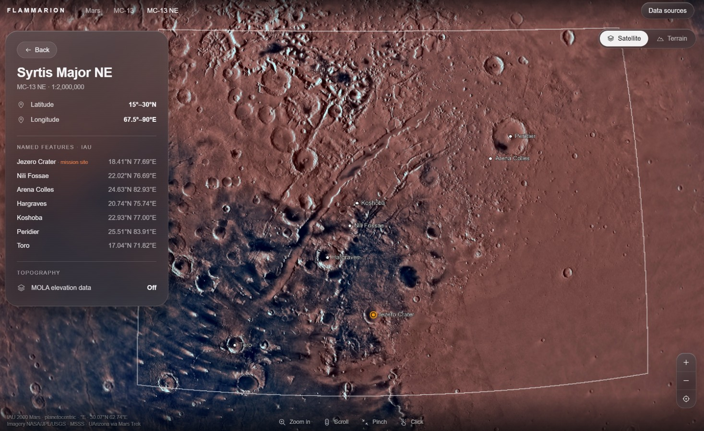
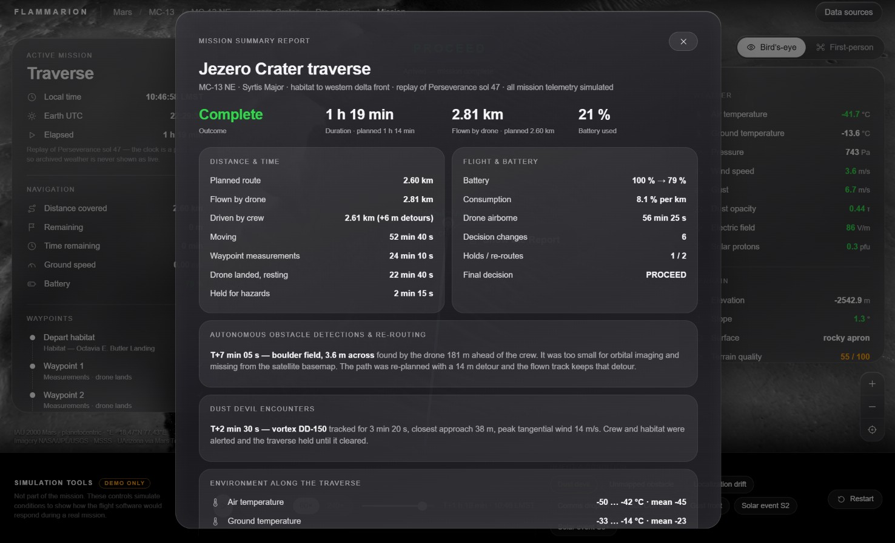

# FLAMMARION

A 3D web app for planning and monitoring a crewed traverse on Mars. You zoom from the full globe down to Jezero Crater, review a proposed route, get a GO / NO-GO from the weather forecast, then watch the traverse play out with a scout drone, live telemetry and automatic HOLD / REROUTE / ABORT decisions. Built for a NASA hackathon; it runs entirely in the browser on real NASA imagery, terrain and Perseverance weather data.

## How to open the app

You need [Node.js](https://nodejs.org) 20 or newer and an internet connection (the Mars imagery is streamed from NASA).

1. Get the code. The app currently lives on the `claude/new-session-uabkbg` branch, not on `main`:

```bash
git clone -b claude/new-session-uabkbg https://github.com/Barnabaki/FLAMMARION.git
```

```bash
cd FLAMMARION
```

2. Install the dependencies (once):

```bash
npm install
```

3. Start the app:

```bash
npm run dev
```

4. Open http://localhost:5173 in Chrome, Edge or Firefox. Keep the terminal open while you use the app; press `Ctrl+C` in it to stop.

### Using it

1. Pick the **Jezero Crater** mission, then click the planet to show the 30 official map regions.
2. Hover a region to preview it, click **MC-13 Syrtis Major**, then the **NE** quadrant, then **Jezero Crater** (on the map or in the feature list). An orange pulse marks the mission site on the way down.
3. Inspect the site and click **Plan this route**.
4. Watch the forecast and, with the assessment at **GO**, click **Start Mission**.
5. In the mission view, switch between **Bird's-eye** and **First-person**, and use **Simulation tools** to change the playback speed or trigger a dust devil, an unmapped obstacle and other conditions.
6. When the traverse ends, click **Show the Report**.

| | | |
|:---:|:---:|:---:|
|  |  |  |
| **1.** Pick the mission and region | **2.** Zoom into Jezero Crater | **3.** Plan the route |
|  |  |  |
| **4.** Start the mission | **5.** Watch the traverse | **6.** View the report |

Hover any value to see what kind of data it is; click it to open **Data sources** at its source. The breadcrumb takes you back to any earlier level, and **Satellite / Terrain** switches the globe between imagery and MOLA elevation.

## Development

| Command | Purpose |
| --- | --- |
| `npm run build` / `npm run preview` | Production build into `dist/` and local preview |
| `npm run generate` | Regenerate every file in `public/data/` and `examples/` (deterministic, seeded) |
| `npm test` | 14 checks: geodesy, Mars24 reference epoch, quadrangle geometry, 30 cm localization model, decision engine, all anomaly scenarios, drone-schema validation, DEM and MEDA consistency with the source files |
| `python3 scripts/build_app_assets.py` | Rebuild the derived assets (terrain grid, route DEM crop, weather tables, MOLA crop) from `data/source/`; needs numpy, pillow, tifffile, imagecodecs. Outputs are committed. |

`npm install` copies Cesium's runtime assets to `public/cesiumStatic/` (git-ignored) via `scripts/copy-cesium.mjs`.

## What is in the demo

- **Module A** — realistic globe (Viking colour mosaic); click the planet for the 30 official Mars Chart quadrangles; select MC-13 → NE quadrant → Jezero; optional MOLA elevation overlay; top-down HiRISE/CTX map on the CTX DEM terrain with the proposed route, waypoints, geodesic distance, DEM elevation profile and MEDA environment. Breadcrumb is clickable at every level.
- **Module B** — forecast time-lapse along the route, predicted distance / time / battery, six explicit GO / NO-GO criteria with the driver named on NO-GO, a what-if dust event, and **Start Mission**.
- **Module C** — replay of the stored telemetry stream at 1×–240× with scrubbing; Screen 1 (bird's-eye, camera follows the crew, free orbit) and Screen 2 (first person); crew + scout drone with localization, comm links, clocks (LMST / LTST / UTC), navigation, milestones, terrain, E-field, life support, comms; decision engine (ABORT / HOLD / PROCEED / REROUTE) with log; eight injectable anomalies including the required dust-devil → alert to crew + habitat → HOLD.
- **Provenance** — every value carries a tag (SATELLITE, IAU, COMPUTED, HISTORIC, MODELLED, SIMULATED, EMULATED, DEMO). Global *Data sources* panel in the top bar.

## Data status

Integrated from the team's data pull (`data/source/`, see `DATA_SOURCES.md`):

- **Weather — HISTORIC.** Air temperature, ground temperature, pressure, wind speed and UV are Perseverance/MEDA measurements (NASA PDS, sols 44–51, Ls 26–30°), averaged per local-true-solar-time hour and replayed by local time. The mission clock is a replay epoch (Perseverance sol 47, 2021-04-07).
- **Terrain — SATELLITE.** The Jezero terrain mesh, waypoint elevations, elevation profile and slopes come from the Mars 2020 CTX DEM mosaic (20 m).
- **MOLA.** The Satellite / Terrain toggle shows the global MGS MOLA colour shaded relief streamed from NASA Mars Trek; the MEGDR tile you pulled is archived in `data/source/mola/`.
- **Named features.** 1,653 IAU-named features across the 30 regions, pulled from the Mars Trek nomenclature index (`data/source/nomenclature/`).
- **REMS (Gale).** Shown in Pre-mission as a labelled reference only.

Still open — read before demoing:

1. **Wind direction, humidity, dust opacity τ, vortex rate and total solar flux are MODELLED** — they were not in the MEDA pull. τ and vortex rate feed two of the six GO / NO-GO criteria.
2. **MEDA wind is sparse at night** (1–3 sols per hour bin outside 11:00–16:00 LTST).
3. **No numeric MOLA grid** was supplied (only its colour image), so outside Jezero the terrain is the reference spheroid; the DEM edge is tapered to it over 0.6°.
4. **Murray Lab CTX mosaic** is still missing; Jezero CTX comes from the USGS mosaics on NASA Mars Trek.
5. **CRISM composition** is not integrated; terrain class/quality per leg is an interpretation of the HiRISE imagery (MODELLED).

Details and every other assumption: `ASSUMPTIONS.md`.

## Architecture

```
index.html
src/
  main.js          app shell: top bar, breadcrumb, stage switching, sources panel
  viewer.js        Cesium viewer on the Mars ellipsoid + NASA Trek imagery layers
  moduleA.js       globe → quadrangles → MC-13 → NE → Jezero terrain & route
  moduleB.js       pre-mission forecast, GO / NO-GO, Start Mission
  moduleC.js       intra-mission HUD, two screens, drone marker, demo-only simulation tools footer
  routeLayer.js    route / waypoint / crew entities shared by all modules
  sources.js       provenance tags and the dataset list behind the Data sources panel
  style.css        Liquid Glass UI styles
  ui/              DOM helpers (dom.js) and line icons (icons.js)
  lib/             pure JS, no DOM — shared by browser, generator and tests
    mars.js        spheroid constants, Vincenty geodesic, seeded PRNG, 30 cm (95 %) localization model
    marsTime.js    Mars24 (MSD, MTC, LMST, LTST, Ls, Sun elevation)
    quadrangles.js MC-01…MC-30 and quadrants
    features.js    generated: IAU-named features per region (scripts/build_features.py)
    weather.js     MEDA hourly means (HISTORIC) + modelled channels; REMS reference
    weatherTable.js, demRoute.js   generated from data/source by build_app_assets.py
    dem.js         elevation lookup on the 20 m CTX DEM crop
    mission.js     waypoints, vehicle model, nominal plan, GO criteria
    decision.js    flags, thresholds, priority, debounce / hold-off
    sim.js         tick-by-tick replay + anomaly scenarios + drone message
scripts/generate-data.mjs   seeded generator for public/data and examples
scripts/build_app_assets.py derives app assets from data/source
scripts/build_features.py   builds src/lib/features.js from the nomenclature pull
scripts/copy-cesium.mjs     copies Cesium runtime assets to public/cesiumStatic/ on npm install
scripts/pull/      the team's download/aggregation scripts (MEDA, REMS, DEM)
data/source/       pulled source data: dem/, weather/, mola/, nomenclature/, SOURCES.json
public/data/       route.geojson, telemetry.ndjson, weather_sol.json, rems_gale_reference.json, dustdevil_scenario.*, terrain/
drone_message_schema.json   proposed drone downlink format (+ examples/)
tests/all.test.mjs
visuals/           diagrams/ (architecture graphic), screens/ (screenshots), svg/ (drone marker icon)
architecture.mmd   Mermaid source of the architecture diagram below
```

<a href="visuals/diagrams/system%20architecture.png" title="Open the full-size diagram">
  
</a>

<sub>Click the diagram to open it at full size (7883 × 1532 px). Source: [`architecture.mmd`](architecture.mmd).</sub>

One route object (`src/lib/mission.js` → `buildPlan()`) is passed A → B → C. One CRS everywhere: IAU 2000 Mars, planetocentric latitude, east-positive longitude 0–360°E.

### Tech stack rationale

- **CesiumJS 1.135** — the only mainstream web globe with a first-class non-Earth ellipsoid (`Ellipsoid.MARS`), tiled imagery LOD and smooth camera flights, which is what "one continuous zoom from globe to 25 cm/px" needs.
- **Vite, no UI framework** — the UI is a handful of panels updated at frame rate; plain DOM keeps the bundle and the moving parts small.
- **Pure-JS `lib/`** — the same code runs in the browser, in the data generator and in `node --test`, so the simulation shown is the simulation tested.
- **NDJSON stream + client clock** — storage-backed "real-time" replay with a configurable rate, deterministic scrubbing (state is re-derived by replaying from tick 0).

Cesium package note: `cesium@1.135.0` declares loose ranges that currently resolve to two incompatible copies of `@cesium/engine`; `package.json` pins `@cesium/widgets@14.3.0` via `overrides` to avoid that.
